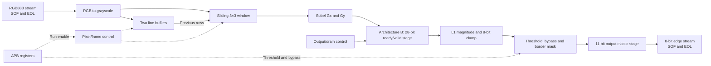
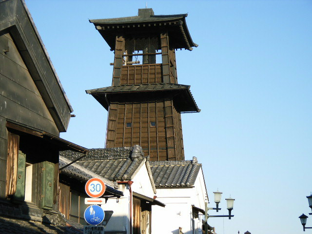
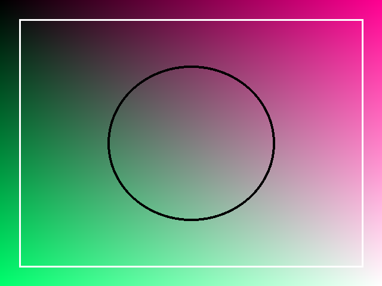
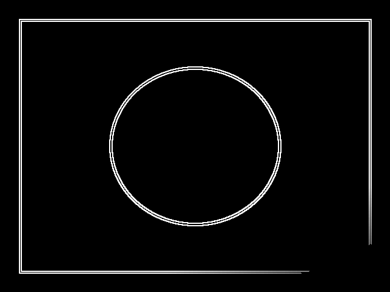

# From RTL to Pixels — Streaming Sobel RTL Accelerator

A synthesizable SystemVerilog pipeline converts an RGB888 pixel stream into an 8-bit Sobel edge stream. This project compares a compact datapath (Architecture A) with a version that inserts one ready/valid stage after the Sobel gradients (Architecture B). The same reference model and frame tests are used for both.

The results combine RTL simulation, selected bounded formal checks, Yosys synthesis and single-seed routed timing on a virtual ECP5 target. No physical FPGA measurement is claimed.

## Architecture

RGB pixels are converted to grayscale, stored in two line buffers and combined with horizontal history into a 3×3 window. Signed Sobel gradients feed an L1 magnitude calculation, 8-bit clamp, threshold/bypass selection and an elastic output stage. Border pixels are forced to zero. The APB-style register block controls run admission, threshold and bypass, and reports status and frame count.



Architecture A connects the Sobel gradients directly to the magnitude and threshold path. B inserts one 28-bit elastic token after Gx/Gy; it carries the gradients, border flag, SOF/EOL and final-token metadata together. Backpressure propagates through the ready/valid stages. A transfer occurs only when `valid` and `ready` are both asserted. SOF is `tuser`; EOL is `tlast`.

The [RTL-derived architecture views](docs/MICROARCHITECTURE.md) show both variants and the module interfaces. They are explanatory diagrams, not synthesized netlists: [system context](docs/assets/rtl-system-context.svg), [Architecture A](docs/assets/rtl-architecture-a.svg), [Architecture B](docs/assets/rtl-architecture-b.svg), [module interfaces](docs/assets/rtl-module-interfaces.svg), [ready/valid control flow](docs/assets/rtl-control-flow.svg), and [editable diagrams.net source](docs/assets/rtl-architecture.drawio).

## Verification

The Python reference model is independent of the RTL. Cocotb tests cover arithmetic, frame alignment and drain, source gaps, output stalls, reset, malformed metadata recovery, APB accesses and frame-consistent configuration. The recorded dimension regression includes 18 deterministic random frames (three at each of six dimensions) and the canonical 640×480 image; the saved logs report zero reference mismatches. Architecture A and B also produce matching complete images in the canonical comparison.

Selected formal jobs check local elastic-stage, APB/configuration, pixel-control, output-control and final-token/frame-count properties under documented assumptions. They do not prove the whole image datapath. Eventual drain is derived under an explicit downstream fairness condition, not claimed as unconditional liveness proof. See [formal scope and results](docs/FORMAL.md) and the [evidence index](docs/EVIDENCE_INDEX.md).

## Implementation results

Both architectures use the same 640×480 RTL workload, ECP5 LFE5U-45F CABGA381 speed-grade-6 target, seed 1 and recorded Yosys/nextpnr settings. The frequency entries are tested constraint points, not a measured device Fmax.

| Metric | A: compact | B: pipelined |
|---|---:|---:|
| LUT4 | 665 | 775 |
| TRELLIS_FF | 194 | 223 |
| CCU2C | 113 | 110 |
| DP16KD / MULT18X18D | 2 / 3 | 2 / 3 |
| Highest tested clean / lowest tested fail constraint | 35 / 40 MHz | 60 / 65 MHz |
| Routed synchronous path | 25.731 ns | 16.194 ns |
| First output / frame completion | 642 / 307842 cycles | 643 / 307843 cycles |
| Input and output initiation interval | 1 cycle | 1 cycle |

The routed path and constraint bracket improved in this one-seed comparison; B also uses 110 more LUT4s and 29 more flip-flops and adds one cycle to first output and frame completion. These results support B as the timing-oriented variant in this tested setup. They are not evidence of board-level timing or physical throughput. The full [A/B comparison](docs/ARCHITECTURE_COMPARISON.md) includes additional mapped-cell counts and derived rates.

## Visual results

The images below show the canonical input, simulated RTL output and image difference for the two architectures. The difference images are zero-valued; they illustrate simulation agreement with the Python reference, not hardware measurements.

| Input | Architecture B output | A/B difference |
|---|---|---|
|  |  |  |
|  |  |  |

## Reproduction

Python development dependencies are needed for simulation. OSS CAD Suite is also required for formal and implementation commands; [`scripts/doctor.py`](scripts/doctor.py) checks the local tools and `make help` lists the supported targets. The common simulation checks can be run with:

```sh
python3 -m venv .venv
source .venv/bin/activate
python -m pip install -r requirements-dev.txt
make doctor
make lint
make test-unit
make test
make test-real-image
```

With `OSS_CAD_SUITE_ROOT` configured, run selected formal checks and the implementation comparison using `make formal` and `make ppa`. Individual synthesis and timing targets are listed by `make help`. Routed timing requires the documented external tools and is a virtual-device result.

## Limitations

- Timing is a seed-1 virtual ECP5 result. No FPGA board, physical throughput measurement or statistically robust Fmax search is claimed.
- The measured 35/40 MHz and 60/65 MHz values are clean/failing constraint brackets. They are distinct from the 38.8636 MHz and 61.7513 MHz post-route tool-reported achieved-clock values.
- Dimensions are compile-time parameters. The design has one clock and does not accept a new frame until the previous frame's final output transfers.
- This is not a full AXI4-Stream implementation and includes no framebuffer, DMA, display controller, CPU, Linux or CNN.
- Formal checks are targeted and assumption-bounded; no whole-accelerator proof is claimed.
- Debug fault-injection case studies are historical isolated-branch work; no deliberate defect remains on `main`.

## Repository map

| Path | Contents |
|---|---|
| [`rtl/`](rtl/) | Synthesizable SystemVerilog |
| [`tb/reference/`](tb/reference/) and [`tb/tests/`](tb/tests/) | Python oracle and cocotb tests |
| [`formal/`](formal/) | Selected formal harnesses and properties |
| [`scripts/`](scripts/) | Regression, formal, synthesis and timing runners |
| [`docs/`](docs/) | Requirements, architecture, timing, evidence and limitations |
| [`results/raw/`](results/raw/) | Preserved tool logs and reports |
| [`results/processed/`](results/processed/) | Reviewed result images and summaries |

Start with [requirements](docs/REQUIREMENTS.md), [architecture](docs/MICROARCHITECTURE.md), [timing](docs/TIMING.md), [A/B comparison](docs/ARCHITECTURE_COMPARISON.md), [known limitations](docs/KNOWN_LIMITATIONS.md), or the [evidence index](docs/EVIDENCE_INDEX.md).

## Provenance and copyright

The accelerator RTL, reference model, verification, formal properties and project diagrams are original project work. The canonical photograph is a public-domain Wikimedia Commons image; its source and hash are recorded in [third-party notices](THIRD_PARTY_NOTICES.md). See [copyright](COPYRIGHT.md).
